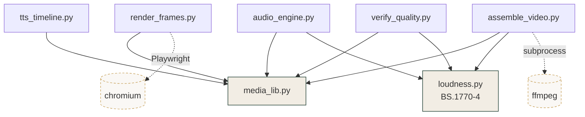

# high-end-product-video

**高品质短视频工业级工作流：声音时钟逆推 + 确定性帧渲染 + 侧链闪避混音 + 响度母带 + 可执行质量门禁。**

一句话说明它解决什么问题：先定画面再拿音频硬凑，必然抢拍、空转、人声被 BGM 盖住。这个工作流把顺序倒过来——**画面时长由旁白的真实波形反推**，然后用一条全脚本化的流水线把成片做出来，每个环节都有可度量的质量基线，交付前由门禁逐项拦截。

**不限题材。** 产品宣传（任意品类）、知识讲解、教程演示、品牌故事、活动回顾、个人 IP 口播——只要是「旁白驱动」的短视频，流程完全一样，变的只有旁白文本和镜头类型（`examples/` 里放了一条精品咖啡宣传片样例）。

- 零密钥硬编码：脚本里不出现任何明文 key，`existing` 模式甚至不需要密钥
- 零标准库外依赖（音频/时间轴/门禁部分）：`tts_timeline`、`audio_engine`、`verify_quality` 只用 Python 标准库
- 可复现：帧序列是 `t = n/fps` 的纯函数，同样输入永远得到同一帧
- 可度量：-16 LUFS / -1.0 dBTP / 4500 kbps / 无死帧 / 无人声重叠，全部由脚本检查

> 前身是一份从企业微信流传出来的 SKILL 草稿：方法论有真东西（声音时钟、侧链闪避参数），但工程上是空壳，还硬编码了一枚 MiniMax API Key。本项目是把那套方法论落成可运行、可门禁、可复现的工程，并把适用面从科技产品宣传扩展到一切旁白驱动的短视频。修正记录见 [CHANGELOG](CHANGELOG.md)。

---

## 架构

```mermaid
flowchart LR
    subgraph IN["输入（全部本地）"]
        A1["旁白文本<br/>narration.txt<br/>每行一句"]
        A2["视觉描述<br/>visuals.json<br/>每镜头类型+文案"]
        A3["BGM<br/>自备 wav"]
    end

    subgraph S1["① 时间轴 tts_timeline.py"]
        B1["TTS 生成旁白<br/>offline / edge / existing"]
        B2["VAD 提取真实波形边界"]
        B3["反推镜头时长<br/>T = T_voice + 0.6 + 0.4"]
        B1 --> B2 --> B3
    end

    subgraph S2["② 渲染 render_frames.py"]
        C1["HTML 模板<br/>templates/scenes.html"]
        C2["__render(t) 纯函数"]
        C3["Playwright 逐帧截图<br/>自适应并发 + 白屏重试"]
        C1 --> C2 --> C3
    end

    subgraph S3["③ 混音 audio_engine.py"]
        D1["人声按时间轴铺轨"]
        D2["侧链闪避<br/>人声 18% / 停顿 35%<br/>250ms 过渡"]
        D3["母带链<br/>K 加权 → -16 LUFS<br/>真峰限幅 -1.0 dBTP"]
        D1 --> D2 --> D3
    end

    subgraph S4["④ 合成 assemble_video.py"]
        E1["FFmpeg<br/>x264 crf16 / 4500k<br/>AAC 192k / faststart"]
        E2["--verify 解码复测"]
        E1 --> E2
    end

    subgraph S5["⑤ 门禁 verify_quality.py"]
        F1["响度 / 真峰值 / 人声间隙<br/>时间轴连续 / 字幕乱码<br/>帧序列 / 死帧"]
    end

    A1 --> B1
    A2 --> C1
    B3 -->|"timeline.json"| C3
    B3 --> D1
    A3 --> D2
    C3 -->|"frames/ (JPEG)"| E1
    D3 -->|"master.wav"| E1
    E2 --> F1
    B3 --> F1
    F1 -->|"全绿才交付"| G["final.mp4"]

    style IN fill:#F2EDE4,stroke:#1B3A2E,color:#2C2C2A
    style S1 fill:#FAF8F5,stroke:#1B3A2E,color:#2C2C2A
    style S2 fill:#FAF8F5,stroke:#1B3A2E,color:#2C2C2A
    style S3 fill:#FAF8F5,stroke:#1B3A2E,color:#2C2C2A
    style S4 fill:#FAF8F5,stroke:#1B3A2E,color:#2C2C2A
    style S5 fill:#FAF8F5,stroke:#C8A35E,color:#2C2C2A
    style G fill:#1B3A2E,stroke:#1B3A2E,color:#FAF8F5
```



模块依赖：



---

## 快速开始

```bash
# 依赖：Python 3.8+；渲染装 playwright + chromium；合成装 ffmpeg
pip install playwright && playwright install
brew install ffmpeg        # 或 apt install ffmpeg

# 一条命令跑通离线模式（占位人声，验证流水线）
python3 scripts/tts_timeline.py examples/narration.txt --mode offline --out timeline.json
python3 scripts/render_frames.py --timeline timeline.json --template templates/scenes.html \
    --visuals examples/visuals.json --out frames --fps 30 --dry-run
```

完整出片（真实人声）：

```bash
# 1. 时间轴：edge-tts 高质量人声（密钥走 edge-tts 自己的环境变量）
python3 scripts/tts_timeline.py examples/narration.txt --mode edge --out timeline.json

# 2. 渲染：537 帧 @ 1920x1080，约 30 秒
python3 scripts/render_frames.py --timeline timeline.json --template templates/scenes.html \
    --visuals examples/visuals.json --out frames --fps 30

# 3. 混音：-16 LUFS / -1.0 dBTP 母带
python3 scripts/audio_engine.py --timeline timeline.json --bgm bgm.wav --out master.wav

# 4. 合成 + 复验
python3 scripts/assemble_video.py --frames frames --audio master.wav --out final.mp4 --verify

# 5. 门禁：全绿才交付
python3 scripts/verify_quality.py --timeline timeline.json --audio master.wav \
    --frames frames --fps 30 --lufs -16 --strict
```

---

## 四个脚本怎么用

### `tts_timeline.py` — 声音时钟逆推

| 参数 | 说明 |
|---|---|
| `script`（位置参数）| 旁白文本，每行一句，`#` 开头忽略 |
| `--mode offline\|edge\|existing` | 离线合成占位音频 / edge-tts / 用已有 wav |
| `--voice` | edge 模式音色，默认 `zh-CN-YunxiNeural` |
| `--audio-dir` | 音频输出/输入目录，默认 `./voice` |
| `--pre / --post` | 前/后留白，默认 0.6 / 0.4 秒 |
| `--md` | 同时输出可读的 Markdown 时间轴 |

产出 `timeline.json`：每镜头含 `voice_start/voice_end/voice_duration`（VAD 提取）与 `scene_start/scene_end/scene_duration`（反推）。

### `render_frames.py` — 确定性渲染

| 参数 | 说明 |
|---|---|
| `--timeline` / `--template` | 时间轴 + HTML 模板 |
| `--visuals` | 镜头视觉描述：每行一个类型，或 JSON 数组（类型 + 文案） |
| `--preset landscape\|vertical\|square\|wide` | 画幅，或用 `--width/--height` 自定义 |
| `--theme editorial\|dark` | 模板主题 |
| `--format jpeg\|png` | 默认 jpeg q92（快 15 倍），png 用于像素级无损 |
| `--dry-run` | 每镜头只渲 1 帧（取 45% 处），快速验证模板 |
| `--workers` | 并发 Page 数，0 = 自动（cpu//2，2~6） |

产出帧序列（`000000.jpg` 起，6 位补零）+ `manifest.json`。

### `audio_engine.py` — 侧链闪避 + 母带

| 参数 | 说明 |
|---|---|
| `--timeline` / `--bgm` / `--no-bgm` | 时间轴 / BGM 文件 / 不要 BGM |
| `--lufs-mode lufs\|peak` | lufs = 响度归一 + 真峰限幅（默认）；peak = 旧版峰值归一 |
| `--lufs / --tp` | 目标 -16 LUFS / -1.0 dBTP |
| `--duck / --rest / --transition` | 闪避 0.18 / 恢复 0.35 / 过渡 0.25s |

产出 `master.wav`（48kHz 16bit）。纯 Python 下 60s 音频母带处理约 10~20s。

### `verify_quality.py` — 质量门禁

九项检查，硬性失败退出码 1。完整说明见 [SKILL.md](skill/SKILL.md) 第七节。

---

## 质量基线（交付标准）

| 指标 | 值 | 谁检查 |
|---|---|---|
| 集成响度 | -16 LUFS ±1 | `LOUDNESS_TARGET` |
| 真峰值 | ≤ -1.0 dBTP（4x 过采样）| `TRUE_PEAK_CEILING` |
| 视频码率 | 4500 kbps 封顶（crf 16）| `assemble_video.py` |
| 人声间隙 | ≥ 0.3s | `NO_SPEECH_OVERLAP` |
| 死帧 | 两帧跨度灰度差 ≥ 0.25（排除转场窗口）| `MOTION_ALIVE` |
| 帧序列 | 帧数 = 时长 × fps，编号连续，尺寸一致 | `FRAME_SEQUENCE` |

## 目录结构

```
high-end-product-video/
├── skill/SKILL.md            # Skill 入口（给 Agent 读的）
├── scripts/
│   ├── tts_timeline.py       # ① 声音时钟逆推
│   ├── render_frames.py      # ② 确定性帧渲染（Playwright）
│   ├── audio_engine.py       # ③ 侧链闪避 + 响度母带
│   ├── assemble_video.py     # ④ FFmpeg 合成
│   ├── verify_quality.py     # ⑤ 质量门禁
│   ├── media_lib.py          # 共享原语（WAV/PNG/灰度/帧流）
│   └── loudness.py           # BS.1770-4 响度与真峰值
├── templates/scenes.html     # 默认场景模板（editorial/dark 双主题）
├── references/
│   ├── design-system.md      # 动态设计系统（模板改造依据）
│   └── mixing-notes.md       # 混音与母带笔记（实现依据）
├── examples/                 # 旁白与视觉描述样例
├── tests/                    # pytest 回归（含 ITU 系数对照）
└── .github/workflows/ci.yml  # CI：测试 + 编译检查
```

## 依赖矩阵

| 脚本 | Python 标准库 | Playwright | FFmpeg |
|---|---|---|---|
| `tts_timeline.py` | ✅ | — | — |
| `audio_engine.py` | ✅ | — | — |
| `verify_quality.py` | ✅ | — | 可选（JPEG 帧死帧检查需要）|
| `render_frames.py` | ✅ | **必需** | — |
| `assemble_video.py` | ✅ | — | **必需** |

## 安全说明

- 脚本内**没有任何硬编码密钥**；`edge` 模式的 TTS 命令由你给出，密钥走你自己的环境变量
- 如果你在使用从其他渠道获得的旧版 SKILL：请检查并吊销其中硬编码的 MiniMax Key（旧版形如 `os.environ.get('MM_KEY', 'sk-...')`），已泄露的 key 必须在控制台吊销，改代码不等于吊销

## 测试

```bash
python -m pytest tests/ -v
```

覆盖：K 加权系数对照 ITU 公布值（48kHz 误差 < 1e-12）、门控响度、真峰值、限幅收敛、时间轴反推、门禁正反例、离线模式全链路。

## License

MIT，见 [LICENSE](LICENSE)。
